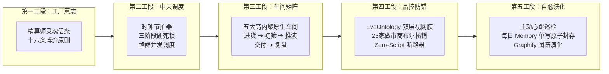
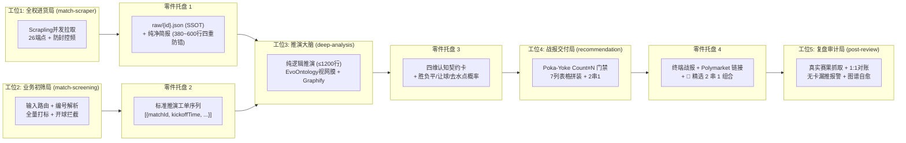
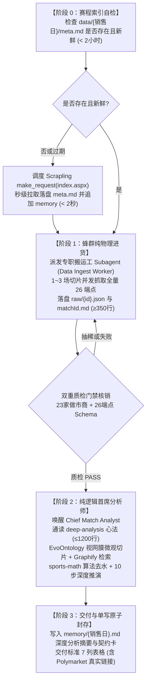
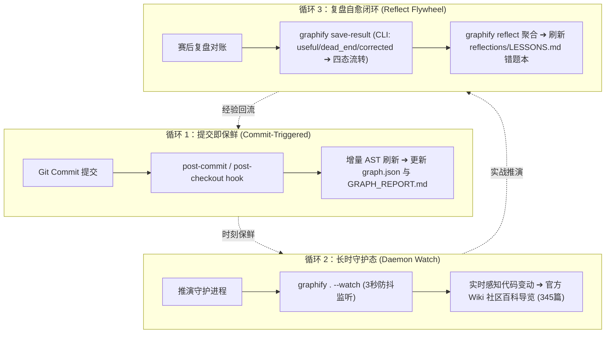

<div align="center">

# ⚡ Pansuan Engine (盘算引擎)
### 现代工业 4.0 足彩倍率分析推演智能工厂 · 乔布斯式乐团指挥家中央总控台 (Command & Dispatch NOC)

[](AGENTS.md)
[](AGENTS.md#第四工段流水线品控防错与工业安全断路器)
[](#多平台-ai-agent-原生适配)
[](https://github.com/D4Vinci/Scrapling)
[](https://github.com/ruc-datalab/EvoOntology)
[](#底层硬核技术基座与-mcp-机械臂矩阵)
[](https://github.com/Graphify-Labs/graphify)
[](https://github.com/alibaba/skill-up)

<p align="center">
  <b>立足庄家精算第一性原理 · 净赔付最小化 · 双盘联动博弈 · 神经中枢与车间统一</b><br/>
  <i>面向职业足彩盘口分析的多智能体分布式量化生产线与认知自愈闭环</i>
</p>

---

</div>

## 🏭 工厂愿景与第一性原理

**Pansuan Engine** 深刻融入马克思唯物主义关于“**高度专业化分工、科学流水线生产节拍器、神经中枢与执行车间相统一**”的现代工业 4.0 智慧：

- **拒绝黑盒玄学，回归做市本源**：从胜平负、让球与大小球的初盘和变动，逆向解构庄家如何诱买、阻热及控制风险；欧亚背离优先审让球防守底线，逆向线路移动（RLM）主动追查尖锐资金痕迹。
- **乔布斯式乐团指挥家架构（Conductor Mindset）**：`AGENTS.md` 纯化为手持指挥棒的中央调度总控台，掌控全场节拍与质量防错（Poka-Yoke），绝不亲自手持乐器演奏；微调无损迁移具体采掘与排版细则至五大车间，原位留驻权威指挥令牌与零件托盘标准契约指针。
- **全库零临时脚本硬铁律（Zero-Script Invariant）**：主仓库 100% 蜕变为纯 Agent 认知与知识库圣殿，杜绝任何全语种（`.py/.ps1/.js/.bat/.sh`）临时脚本与磁盘 `tmp_*` 暂存中转。
- **全流程 MCP 机械臂闭环**：数据进货 100% 调度官方 Scrapling 原生流式通道，做市看数 100% 依托 EvoOntology 双层视网膜微观切片，纯数学算力外挂宿主独立服务（Goto 2026 OO-EPC 去水 + Dixon-Coles 修正泊松），全量理论反思依托 Graphify 5.6MB 博弈图谱。

---

## 🏛️ 中央总控台五大工段架构 (Command & Dispatch NOC)

全系统中央总控台详见 [`AGENTS.md`](AGENTS.md)，划分为五大严密协同的工业级工段：



| 工段编号 | 核心职能 | 关键机制与工业标准 |
| :---: | :--- | :--- |
| **第一工段** | **工厂意志与精算师最高灵魂宪章** | 确立精算师六大核心特质、十六条做市博弈第一性原则、沟通风格与行为边界。 |
| **第二工段** | **中央总控台调度系统与节拍器** | 会话启动三部曲、推演态三阶段硬死锁（阶段 0 ➔ 1 ➔ 2）、蜂群 Central Scheduler 滑动窗口流控。 |
| **第三工段** | **五大专业化生产车间工位矩阵** | 五大原生车间工位标准化契约、输入输出报文规范与十六大实操推演心法。 |
| **第四工段** | **流水线品控防错与工业安全断路器** | EvoOntology 官方视网膜、法定 26 端点与 23 家机构机位核销、全语种零临时脚本铁律、人类简报四重品控防错门禁（Anti-Ad/Anti-Collapse/Anti-Placeholder/23CIDs）。 |
| **第五工段** | **巡检自愈、成品仓储与系统演化中枢** | 赛前/临盘/赛后三大主动巡检、每日 `memory/YYYY-MM-DD.md` 唯一单写原子封存、Graphify 图谱演进。 |

---

## 🛠️ 五大专业化生产车间工位矩阵

系统解散历史单体冗余结构，解耦落地为五大独立、高内聚、零耦合的原生 Skill 生产车间，车间之间通过不可篡改的标准契约零件托盘（Parts Trays）交接：



```
skills/
├── match-scraper/      # 工位 1：全权数据进货局 (Scrapling MCP 官方原生流式并发)
├── match-screening/    # 工位 2：业务初筛局 (4 种输入路由 + 开球拦截 + 标准工单)
├── deep-analysis/      # 工位 3：推演大脑总装局 (纯逻辑推演 ≤1200行 + 四维认知契约卡)
├── recommendation/     # 工位 4：战报交付局 (Poka-Yoke 门禁 + 标准 7 列表格 + 2 串 1)
└── post-review/        # 工位 5：复盘审计局 (双列 1:1 真实对账 + 认知图谱自愈)
```

| 车间工位 | 核心职责（高内聚） | 机械臂绑定与标准协议 | 工业标准出厂零件托盘（零耦合接口） |
| :--- | :--- | :--- | :--- |
| **工位 1：全权数据进货局**<br/>`skills/match-scraper` | 赛程索引抓取、26 底层端点长连接并发提取、23 家机构核销、单 IP 防封控频 | `scrapling` MCP (`open_request_session`, `session_make_request`, `close_session`) 带 `impersonate="chrome"` 与三路分流提取 | **零件托盘 1**：`data/{销售日}/raw/{id}.json` (26 端点原生报文 SSOT) + `matchId.md` (人类简报 $\ge 350$ 行) |
| **工位 2：业务初筛局**<br/>`skills/match-screening` | 方式 1~4 输入统一路由、竞彩编号转换、开球时间先验拦截、全量打标排队 | 纯直读 `meta.md` 赛程索引，**0 外部网络**，严禁按层级淘汰比赛 | **零件托盘 2**：标准推演工单序列 `work_orders: [{matchId, kickoffTime, league, homeTeam, awayTeam, ...}]` |
| **工位 3：推演大脑总装局**<br/>`skills/deep-analysis` | 纯只读微观切片、去水点概率测算、Dixon-Coles 泊松分布、10 步庄家博弈破译（$\le 1200$ 行） | `evo-semantic` MCP (`browse_semantics`, `resolve_semantics`)<br/>`sports-math` MCP (`devig_oo_epc`, `poisson_dixon_coles`)<br/>`graphify` 知识图谱 | **零件托盘 3**：**四维不可篡改【认知契约卡】** + 纯推演单场结果（胜负平、让球、点概率、比分） |
| **工位 4：战报交付局**<br/>`skills/recommendation` | Poka-Yoke `Count(契约卡) ≡ N` 门禁、7 列表格拼装、Polymarket 真实链接核验、文末 2 串 1 优选 | 格式校验闸门（绝不折行、字段强校验、链接真实性）、原子化前置写入 memory | **零件托盘 4**：终端交付物（标准 7 列表格 + 文末【🎯 2 串 1 组合推荐】 + memory 审计底账） |
| **工位 5：复盘审计局**<br/>`skills/post-review` | 真实赛果抓取、1:1 胜负平+让球双列真实对账、赛前无卡漏推红线报警、战法库反思进化 | `graphify` 错题反思导览 + 长期记忆库 (`MEMORY.md`) | **零件托盘 5**：真实完场对账单（含 ✅/❌/走水） + `LESSONS.md` 经验图谱自愈 |

---

## ⏱️ 流水线时钟节拍器：推演态三阶段硬死锁

为杜绝大模型在无物理数据时空转偷跑、提前猜测胜负或违规编写脚本，总控台确立**推演态三阶段硬死锁节拍器**：



---

## 🔬 底层硬核技术基座与 MCP 机械臂矩阵

系统采用“**零临时脚本纯知识库 + 宿主 MCP 机械臂**”顶级工程架构，六大核心工具链全量协同：

| 工具服务 | 官方源 / 规范链接 | 工业定位 | 核心接口与技术规格 |
| :--- | :--- | :--- | :--- |
| **`scrapling`** | [D4Vinci/Scrapling](https://github.com/D4Vinci/Scrapling) | 官方原生数据采集通道 | `open_request_session`, `session_make_request`, `close_session`, `browser_fetch`<br/>Level 1/2 协议流，支持 `impersonate="chrome"`、三路端点参数分流与 Markdown 原生直出 |
| **`evo-semantic`** | [ruc-datalab/EvoOntology](https://github.com/ruc-datalab/EvoOntology) | 专属双层做市看数视网膜 | `browse_semantics`, `resolve_semantics`, `validate_semantics`<br/>法定 23 家做市商机位语义映射与定点微观切片提取，严禁裸视海量原始报文 |
| **`sports-math`** | [宿主独立微服务](file:///C:/Users/home/.gemini/services/sports-math) | 纯数学算力引擎 | `devig_oo_epc`, `poisson_dixon_coles`<br/>东京大学 Shota Goto (2026) 凸优化去水算法与 Dixon-Coles 修正泊松分布 |
| **`graphify`** | [Graphify-Labs/graphify](https://github.com/Graphify-Labs/graphify) | 知识图谱与错题反思中枢 | `query_graph`, `get_node`, `shortest_path`, `god_nodes`, `get_community`, `get_neighbors`, `graph_stats`<br/>5.6MB 全息博弈图谱，支持三大战区调兵、疑难穿透、理论裁决与三重保鲜生命周期 |
| **`skill-up-observer`** | [alibaba/skill-up](https://github.com/alibaba/skill-up) | 技能评测与演化观测器 | `mark_skill_invocation`, `write_observation_case`<br/>阿里巴巴官方 Agent 技能观测与回归用例沉淀体系 |
| **`bigballs-sports-data`** | [Big Balls Data MCP](https://mcp.bigballsdata.com/mcp) | 球员微观体能与真实伤停 | `get_matches`, `get_standings`, `find_players`<br/>覆盖五大联赛与美职足的真实伤停与双赛体能负荷断崖核查 |

### 🧠 Graphify 官方认知飞轮与三重保鲜生命周期 (The 3-Loop Freshness Engine)

全系统 5.6MB 博弈知识图谱与 19 篇顶刊论文资产绝非死数据，而是通过官方原生三重保鲜生命周期时刻满血自驱运转：



1. **循环 1（提交即保鲜 · Git Hook 增量刷新）**：依托系统已注册的 Git `post-commit` / `post-checkout` hooks，在每次代码、战法或文档提交后，秒级增量重构 AST 与拓扑关联，保证知识图谱与本地代码库 100% 绝对同步；
2. **循环 2（长时守护态保鲜 · Watch 守护监听）**：在长时推演运行环境中，调度 `graphify . --watch` 后台守护，3 秒防抖自动捕获新增文件；同时配套 `graphify-out/wiki/` 345 篇针对 23 家做市商机位与典型历史战例的深度维基，供推演大脑随时调阅；
3. **循环 3（赛后自愈归卷 · Reflect 经验自进化）**：每日赛后复盘时，通过 `graphify save-result` 对实战进行经验打标（官方 `--outcome` 支持 `useful` 命中加权、`corrected` 失误纠偏、`dead_end` 淘汰降权，对应假设四态流转：`useful` 验证中、`corrected` 纠偏、`dead_end` 流转为 `retired` 已淘汰、累计验证流转为 `adopted` 已采用），随后调用 `graphify reflect` 聚合并自动刷新 `graphify-out/reflections/LESSONS.md`，实现从赛果真实对账到错题本自愈的闭环演进。

---

## 🤖 多平台 AI Agent 原生适配

本项目不绑定任何单一助手平台，任意具备文件读写与标准 MCP 调度能力的 AI 智能体均可原生接入：

| 平台名称 | 交互通道 | 智能体调度与协作机制 | 推荐应用场景 |
| :--- | :--- | :--- | :--- |
| **反重力 (Google Antigravity)** | 工作区直接加载 | `invoke_subagent` 蜂群任务并发隔离、Graphify 图谱原生穿透 | 深度交互、多场并发切片推演、知识进化 |
| **爱马仕 (Hermes Agent)** | 本地工作区原生交互 / CLI | `delegate_task` 并发调度、Cronjob 周期巡检、渠道 Webhook 交付 | 桌面常驻、无人值守自驱流水线、外部群聊推送 |
| **Claude Code / Cursor** | 终端命令行 / IDE 工作区 | 终端沉浸式交互、代码审查、实时流式推理 | 终端极速诊断、策略规约调优 |

---

## 🚀 生产作业运行模式与交互矩阵

### 1. 自动巡航模式 (Cron Autopilot)

按系统预设的流水线生产时钟自动巡检触发：

- **🌅 每天 11:10 (早盘赛程同步)**：极速拉取当日赛程，落盘 `meta.md` 并展示赛程索引列表（只同步，不盲目推演）。
- **🎯 每天 17:00 / 21:00 (赛前两阶段推演)**：
  - `17:00` 窗口：锁定开球时间 $\le$ 22:00 的早盘赛事；
  - `21:00` 窗口：锁定开球时间 > 22:00 及次日凌晨的晚盘赛事；
  - 无符合窗口场次则主动声明空仓，杜绝无意义消耗。
- **📊 每天 10:30 (赛后复盘自愈)**：抓取真实赛果 ➔ 计算命中率 ➔ 偏差归因 ➔ 追加更新 `MEMORY.md` 战法库。

### 2. 人工交互指令矩阵

| 你对 Agent 说 | 调度室工位执行动作 | 交互门禁响应 |
| :--- | :--- | :--- |
| 「同步赛程」「今天有什么比赛」 | 调度工位 1 拉取最新赛程并落盘 `data/{销售日}/meta.md` | 展示列表后就地停下，等待指令 |
| 「筛选比赛」「帮我筛一下」 | 调度工位 2 启动 6 阶段业务初筛，对当期全部开售比赛打标并排序 | **推送候选清单，等待主人确认** |
| 「指定推演」「分析 002 和 005」 | 启动阶段 1 蜂群进货 ➔ 阶段 2 首席推演 ➔ 阶段 3 战报交付 | 严格执行三阶段硬死锁，全自动闭环 |
| 「给推荐」「今天买什么」 | 全流程端到端自动化推进（同步 ➔ 进货 ➔ 推演 ➔ 交付） | 交付工整标准 7 列表格 |
| 「昨天结果怎么样」「复盘」 | 调度工位 5 执行赛后复盘审计，更新统计指标与对账 | 输出复盘专报与精算师签名 |
| 「今天不分析了」「今天休息」 | 写入当日跳过标记，暂停当日定时推送任务 | 响应确认，保持静默 |

---

## 📂 现代工业级工作区拓扑树

```text
倍率分析推演/
├── .evoontology/             # EvoOntology 本体工程与语义版本管辖
├── config/                  # 静态配置文件与凭据字典 (联赛分级、Token配置)
├── data/                    # 销售日推演原始报文与人类简报
│   └── {销售日}/
│       ├── meta.md          # 当日赛程全景索引
│       ├── {matchId}.md     # 人类可视化推演快照 (≥350行)
│       └── raw/
│           └── {matchId}.json # 法定 26 端点原生报文 SSOT 存证
├── docs/                    # 系统设计规范与工业演化文档
├── graphify-out/            # Graphify 5.6MB 全息博弈知识图谱与反思词条
├── memory/                  # 每日记忆流水线唯一单写原子落盘
│   └── YYYY-MM-DD.md        # 每日战报存盘与认知契约卡
├── skills/                  # 五大高内聚生产车间工位
│   ├── deep-analysis/       # 工位 3：推演大脑总装局 (SKILL.md ≤ 1200行)
│   ├── match-scraper/       # 工位 1：全权数据进货局
│   ├── match-screening/     # 工位 2：业务初筛局
│   ├── post-review/         # 工位 5：复盘审计局
│   └── recommendation/      # 工位 4：战报交付局
├── AGENTS.md                # 核心宪章：五大工段中央总控台与最高行为规约
├── MEMORY.md                # 长期记忆中枢：累计胜率、战法库与血泪教训
├── README.md                # 本文件：智能工厂中央总控台看板与上手指南
└── STRATEGY.md              # 战略大图：产品长期路线图与工业化演进阶梯
```

---

## 🛡️ 工业安全生产守则与红线规约

1. **全语种零临时脚本铁律**：严禁在运行中编写或执行任何 `.py/.ps1/.js/.bat/.sh` 临时脚本，严禁在磁盘建立 `tmp_*` 暂存文件夹或倾倒 `.txt` 中转文件！
2. **法定 23 家做市商机位布尔核销**：大模型/Agents 查看做市赔率必须 100% 依托 EvoOntology 视网膜按映射路径提取 raw JSON 微观数据，严禁后台造假伪造未开盘数据，未开盘如实标记 `[官方未开盘]`。
3. **真实伤停与物理体能前置**：推演胜负前必须查明双方球员微观伤停与双赛体能负荷断崖，未见物理数据前严禁主观盲猜。
4. **标准 7 列表格交付规范**：交付格式绝对锁定为标准 7 列表格，第 7 列不可遗漏 Polymarket 真实链接或官方未开盘说明。
5. **单一主分支与原子 Git 提交**：全系统严格基于 `main` 单一分支推进，严禁未经主人明确授权私自创建临时分支或私自执行破坏性 Git 动作。
6. **全量 1:1 推演与契约卡 Poka-Yoke 强断言**：全量开售场次 100% 逐场推演并封存认知契约卡，强制满足 Count(进货) ≡ Count(推演) ≡ Count(契约卡) ≡ Count(交付行) ≡ N，严禁借口“精选2~3场”偷工减料；精选仅指文末 2 串 1 组合建议。

---

<div align="center">
  <sub>Pansuan Engine · 工业级足球倍率分析推演智能工厂 · 遵循极简、求真、严谨之精算之道</sub>
</div>
