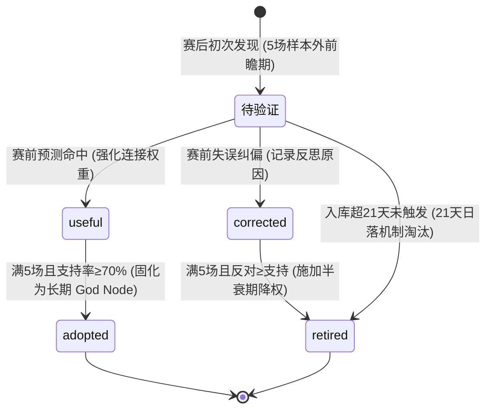

# Graphify 官方体系全景集成手册与实操排错指南 (Official Integration Guide)

> **权威对齐源头**：[Graphify-Labs/graphify (PyPI: graphifyy)](https://github.com/Graphify-Labs/graphify)  
> **工业定位**：足彩倍率分析推演智能工厂 · 认知外脑与学术因果图谱中枢 (Cognitive Graph Engine)  
> **核心资产**：5.64MB 全息因果图谱（`graphify-out/graph.json`）、19 篇顶刊博弈学术论文、345 篇做市商与实战社区维基（`graphify-out/wiki/`）、动态错题自愈本（`graphify-out/reflections/LESSONS.md`）

---

## 目录索引 (Index)

1. [第一章：系统愿景与 Graph-First 认知优先立宪](#第一章系统愿景与-graph-first-认知优先立宪)
2. [第二章：官方 10 大 MCP 工具标准契约规范](#第二章官方-10-大-mcp-工具标准契约规范)
3. [第三章：官方 CLI 子命令与参数完整全集](#第三章官方-cli-子命令与参数完整全集)
4. [第四章：三大推演战区调兵与脱靶自愈实操 SOP](#第四章三大推演战区调兵与脱靶自愈实操-sop)
5. [第五章：赛后 Reflect 四态经验流转与诚实证据链标准](#第五章赛后-reflect-四态经验流转与诚实证据链标准)
6. [第六章：三重保鲜生命周期 (The 3-Loop Freshness Engine)](#第六章三重保鲜生命周期-the-3-loop-freshness-engine)
7. [第七章：Windows 平台实操与常见排错指南](#第七章windows-平台实操与常见排错指南)

---

## 第一章：系统愿景与 Graph-First 认知优先立宪

### 1.1 认知外脑核心定位
在足彩倍率分析推演智能工厂中，Graphify 不是死存盘数据，而是 AI Agents 推演大脑在面临复杂盘赔博弈时随时唤醒的**高信噪比认知外脑**。
- **杜绝两大极端**：既严禁将学术论文当摆设束之高阁（知识吃灰），又严禁大模型裸搜庞杂长代码盲目猜想（幻觉推演）。
- **Graph-First 认知优先铁律**：凡在推演态面临疑难盘口（如客让半一满水退盘、深盘假摔震仓）、做市多机构分歧（平博稳如泰山 vs 商业庄大幅降水）、或理论背离（欧指暗示主胜 vs 亚盘暗示客不败）时，**必须且只能优先通过 Graphify MCP 机械臂检索图谱与社区维基**，以学术因果与经典战例为基准展开破译。

### 1.2 零伪命令行绝对铁律 (Zero Pseudo-CLI Invariant)
大模型在思维链（Thinking Process）或向外输出中，**绝对严禁裸写伪 CLI 脚本**（例如在思维链中写 `graphify query "..."` 假装调用了终端命令）。推演中必须严格调用宿主已注册的标准 MCP 工具接口（`query_graph`, `get_node`, `god_nodes`, `shortest_path` 等），由宿主机械臂完成真实调度。

---

## 第二章：官方 10 大 MCP 工具标准契约规范

宿主 MCP 服务器 `graphify` 原生暴露以下 10 大工具，参数与返回值规范严格对齐官方 Schema：

| 工具名称 (ToolName) | 核心功能与职责 | 必填入参 | 选填入参与默认值 | 典型应用场景 |
| :--- | :--- | :--- | :--- | :--- |
| **`query_graph`** | 基于 BFS/DFS 的图遍历语义检索 | `question` (string) | `mode`: `"bfs"` \| `"dfs"` (默认 `"bfs"`)<br/>`depth`: 1~6 (默认 3)<br/>`token_budget`: int (默认 2000)<br/>`context_filter`: array[string]<br/>`project_path`: string | 战前初诊（BFS）、战区一物理因果穿透（DFS） |
| **`get_node`** | 精确获取单个学术或战法节点详情 | 无（但需指定其一） | `label` (string)<br/>`node_id` (string)<br/>`project_path`: string | 调阅特定论文节点（如 `paper_egidi_2018_combining_historical_and_bookmaker_odds` 或 `label="Egidi, Pauli & Torelli (2018) 结合历史进球数据与庄家隐含赔率的层次贝叶斯泊松模型"`） |
| **`shortest_path`** | 概念间最短因果链路探索 | `source` (string)<br/>`target` (string) | `undirected`: bool (默认 false)<br/>`max_hops`: int (默认 8)<br/>`project_path`: string | 欧亚背离裁决、概念因果桥接 |
| **`god_nodes`** | 提取图谱度数最高的骨干枢纽 | 无 | `top_n`: int (默认 10)<br/>`exclude_hubs_percentile`: number<br/>`project_path`: string | 脱靶自愈、全局博弈心法框架导览 |
| **`get_community`** | 获取特定主题社区聚类及内部节点 | `community_id` (int) | `token_budget`: int (默认 2000)<br/>`project_path`: string | 联赛操盘特征群研究、做市商流派分析 |
| **`get_neighbors`** | 获取节点的直接邻居与边关系 | 无（指定 label/node_id） | `label`: string<br/>`node_id`: string<br/>`relation_filter`: string<br/>`token_budget`: int (默认 2000) | 查看特定盘口特征的所有关联推论 |
| **`graph_stats`** | 返回全图节点数、边数、社区数等宏观统计 | 无 | `project_path`: string | 图谱健康度巡检、增量重构核验 |
| **`get_pr_impact`** | 分析文件变更在图谱中的影响范围 | `files` (array[string]) | `project_path`: string | 工程代码变更影响面评估 |
| **`list_prs`** | 列出当前仓库的活跃 PR 与工作树映射 | 无 | `project_path`: string | CI/CD 与工程流水线协作 |
| **`triage_prs`** | 自动分类与评估 PR 变更风险 | 无 | `project_path`: string | 架构重构风险审查 |

### 标准 MCP 工具调用范式（Python / JSON 报文）

#### 1. 战前初诊：广度扫描 (BFS)
```json
{
  "ServerName": "graphify",
  "ToolName": "query_graph",
  "Arguments": {
    "question": "客场浅让满水退盘 做市诱多",
    "mode": "bfs",
    "depth": 2,
    "token_budget": 1500
  }
}
```

#### 2. 客观因果：深度溯源 (DFS)
```json
{
  "ServerName": "graphify",
  "ToolName": "query_graph",
  "Arguments": {
    "question": "Egidi 泊松独立基准 凸组合借用",
    "mode": "dfs",
    "depth": 3,
    "token_budget": 1500
  }
}
```

#### 3. 理论冲突与背离裁决：最短路径 (shortest_path)
```json
{
  "ServerName": "graphify",
  "ToolName": "shortest_path",
  "Arguments": {
    "source": "欧亚双盘背离",
    "target": "庄家净赔付最小化",
    "undirected": true,
    "max_hops": 6
  }
}
```

#### 4. 脱靶自愈：调取骨干枢纽 (god_nodes)
```json
{
  "ServerName": "graphify",
  "ToolName": "god_nodes",
  "Arguments": {
    "top_n": 10
  }
}
```

---

## 第三章：官方 CLI 子命令与参数完整全集

在自动化批处理、Git Hooks 或复盘脚本中，可直接调用官方 CLI `graphify`：

```bash
# 1. 核心图谱检索与穿透
graphify query "<question>" [--dfs] [--context <filter>] [--seed <node>] [--budget <tokens>] [--graph <path>]
graphify path "<conceptA>" "<conceptB>" [--directed|--undirected] [--graph <path>]
graphify explain "<concept>" [--all] [--graph <path>]
graphify affected "<node>" [--relation <rel>] [--depth <N>] [--graph <path>]
graphify god-nodes [--top <N>] [--json] [--graph <path>]

# 2. 赛后经验反思流水线 (Reflect Flywheel)
graphify save-result --question "<Q>" --answer "<A>" [--type query|path_query|explain] \
                     [--nodes <node1> <node2> ...] \
                     [--outcome useful|dead_end|corrected] \
                     [--correction "<correction_text>"] \
                     [--memory-dir <path>]
graphify reflect [--memory-dir <path>] [--out <lessons_md>] [--half-life-days <N>] [--min-corroboration <N>]

# 3. 图谱新鲜度守护与增量维护
graphify watch <path>                     # 守护态：3秒防抖监听并自动重构
graphify update <path> [--force]          # 极速增量 AST 刷新（无需 LLM API Key）
graphify check-update <path>              # 巡检是否需要语义重构（Cron 安全）
graphify extract <path> [--code-only]     # 全量抽取（AST + 语义 LLM）

# 4. 导出与可视化
graphify export html [--graph <path>]     # 导出单文件交互式 3D 力导向图 (graph.html)
graphify export wiki [--graph <path>]     # 导出 Markdown 百科文章至 wiki/
graphify export callflow-html             # 导出架构调用流 HTML
graphify export obsidian                  # 导出 Obsidian 知识库与 Canvas
graphify tree [--graph <path>]            # 导出 D3 可折叠树形图 (GRAPH_TREE.html)

# 5. Git Hook 治理
graphify hook install                     # 一键安装 post-commit, post-checkout, post-merge
graphify hook status                      # 检查当前 Git Hooks 安装状态
graphify hook uninstall                   # 卸载 Git Hooks
```

---

## 第四章：三大推演战区调兵与脱靶自愈实操 SOP

### 4.1 三大战区主动调兵矩阵
推演大脑在进入阶段二（首席分析师）后，严格遵循三大战区序贯检索：

```
[步骤 1: 赔率就位] ➔ 【触点 1: 战前初诊】 ➔ query_graph(mode="bfs") ➔ 锚定宏观共识 (Kaunitz) 与散户偏见 (Levitt)
[步骤 2-3: 技统客观] ➔ 【触点 2: 战区一因果】 ➔ query_graph(mode="dfs") ➔ 调取独立泊松 (Egidi) 与先验修正 (Macri)
[步骤 8-9: 时序落槌] ➔ 【触点 3: 战区三落槌】 ➔ shortest_path / query_graph ➔ 区分假摔震仓 (Winkelmann) 与让球底线 (Constantinou)
```

1. **战前初诊（触点 1）**：
   - 目的：摸清做市商初始大盘框架与大众认知偏见；
   - 方式：提炼 1~2 个最突出盘口异动特征（如豪门客场受让超高水），调用 `query_graph(mode="bfs", depth=2)`；
   - 联动：查阅 `graphify-out/wiki/` 对应做市商流派背景（如马会防守哨兵 vs 皇冠商业做市）。
2. **客观因果穿透（触点 2）**：
   - 目的：剥离市场噪音，测算物理真实进球期望 $\lambda$；
   - 方式：调用 `query_graph(mode="dfs", depth=3)` 调阅 Egidi 攻防均值凸组合模型，结合 Macri 共度先验核验伤停实际冲击；
   - 约束：纯数学攻防基准另存，不以盘口改写独立泊松。
3. **博弈落槌与背离裁决（触点 3）**：
   - 目的：穿透时序伪装，判定最终防守落点；
   - 方式：面对欧亚盘口背离或假摔退盘，调用 `shortest_path(source="欧亚双盘背离", target="庄家净赔付最小化", undirected=true)`；
   - 裁决原则：**让球盘直面净胜球兑付风险，优先作为庄家真实防守底线**；胜、平、负三端逐一写清证据，消除认知分裂。

### 4.2 脱靶自愈操作规程 (Missed-Target Self-Healing)
由于大模型提取的关键词常带有口语色彩，若图谱检索初次脱靶（返回空或无关联节点），严禁放弃，强制按两级自愈规程收敛：
- **第一级：语义升维（Semantic Up-leveling）**：
  口语词汇自动升维为学术因果概念：
  - `早盘跳水 / 降水出货` $\implies$ `散户偏见收割` 或 `Levitt 2004`
  - `假摔退盘 / 诱空震仓` $\implies$ `隐状态做市假摔` 或 `Winkelmann 2026 Head-Fake`
  - `欧赔深让亚盘卡位` $\implies$ `跨市场几何背离` 或 `Constantinou 2022 亚洲让球盘`
  - `全网平赔高挂 4.00+` $\implies$ `高平筹码真空` 或 `Draw_Vacuum`
- **第二级：枢纽降维锚定（God Node Grounding）**：
  若升维依然无匹配，直接调用 `god_nodes(top_n=10)`，从度数最高的核心公理（Minimax 庄家净赔付最小化、Constantinou 亚洲让球盘、知情交易与尖锐资金）中选定基准，锚定推演主梁。

---

## 第五章：赛后 Reflect 四态经验流转与诚实证据链标准

### 5.1 实战经验四态生命周期 (The 4-State Outcome Lifecycle)
复盘审计不仅仅是记账，而是将真实赛果作为终极检验器，驱动图谱工作记忆动态流转：



1. **`useful`（核心首选命中 · 验证中加权）**：
   赛前核心做市博弈推导链得到赛果正面印证，强化相关论文节点与战法连接权重：
   ```bash
   graphify save-result --question "2981540 芬超 古比斯 客让半一退平半" \
                        --answer "赛前破译Winkelmann假摔震仓首选客胜，实际0-2打出" \
                        --nodes "docs_odds_winkelmann_head_fake" "中盘T2/T3假摔震仓（Head-Fake Shakeout）识别：结合状态空间残差与多庄协同背离穿透诱筹" \
                        --outcome useful \
                        --memory-dir graphify-out/memory
   ```
2. **`corrected`（失误反思纠偏 · 归因改进）**：
   首选未命中或发生重大偏差，启动决策归因审计，指出赛前被忽视的做市陷阱或偏见漏洞：
   ```bash
   graphify save-result --question "3085211 荷乙 埃因霍温FC 均势平手盘平赔顶高4.00" \
                        --answer "赛前误以为平赔高挂一票排平，实际1-1打出" \
                        --nodes "paper_levitt_2004_why_are_gambling_markets_organized_so_differently" "公理二：净赔付最小化（Minimax）决定真实安全落点" \
                        --outcome corrected \
                        --correction "平赔极端顶高散户恐高筹码真空，做市商净赔付最小，不可一票否决平局" \
                        --memory-dir graphify-out/memory
   ```
3. **`retired`（假设被证伪淘汰 · dead_end 惩罚降权）**：
   针对在 5 场前瞻验证中反对数 $\ge$ 支持数、或入库超 21 天无触发的条目，使用官方 `--outcome dead_end` 标记死胡同，促使 `reflect` 施加半衰期惩罚并降权，并在 `MEMORY.md` 标记为「已淘汰」：
   ```bash
   graphify save-result --question "假设检验 澳彩中盘降水一票定胆" \
                        --answer "连续遭遇诱多反杀，经验证该规律不成立" \
                        --nodes "docs_odds_winkelmann_head_fake" \
                        --outcome dead_end \
                        --memory-dir graphify-out/memory
   ```
4. **`adopted`（经验内化转正 · 固化为长期 God Node）**：
   满 5 场前瞻验证且支持率 $\ge 70\%$ 的成熟规律，在 `MEMORY.md` 标记为「已采用（内化为本能）」，其在 `graphify reflect` 中凭借多次 `--outcome useful` 的互证强化（默认 `--min-corroboration 2`），正式固化为长期高频 God Node 核心骨干枢纽。

### 5.2 聚合并刷新 LESSONS.md
复盘审计完成实战打标后，运行：
```bash
graphify reflect --memory-dir graphify-out/memory --out graphify-out/reflections/LESSONS.md
```
该命令会自动聚合并重构 `graphify-out/reflections/LESSONS.md`，使推演大脑次日在阶段二自检时，第一时间加载最新的错题反思与认知覆盖层。

### 5.3 官方诚实证据链标准 (Honesty Rules)
全系统严格贯彻官方诚实准则：
- **必须带入真实 `source_location`**：所有引述的学术论文定理、历史战例或规则节点，必须附带具体文件名与页码/段落（如 `source_location: "docs/论文/2022_Constantinou_AH_1X2.pdf#p12"` 或 `source_location: "graphify-out/wiki/5._平博_欧亚双盘核心.md#L15"`）；
- **严禁虚构文献与口头断言**：禁止使用“据某著名论文”、“根据统计模型”等模糊套话，查无原句者不得入库。

---

## 第六章：三重保鲜生命周期 (The 3-Loop Freshness Engine)

为了保持 5.6MB 知识图谱时刻满血自驱运转，全系统确立三重保鲜生命周期：

```
[循环 1: 提交即保鲜] 每次 Git Commit ➔ post-commit hook 自动触发 ➔ 增量 AST 刷新 ➔ 更新 graph.json / GRAPH_REPORT.md
[循环 2: 守护态保鲜] 长时运行会话 ➔ graphify . --watch 守护进程 ➔ 3秒防抖自动感知文件变动
[循环 3: 复盘自愈闭环] 每日复盘 ➔ graphify save-result 记录实战反馈 ➔ graphify reflect 聚合成 LESSONS.md
```

- **循环 1（提交即保鲜）**：
  系统已配置 Git `post-commit` 与 `post-checkout` hooks。每次执行 `git commit`，钩子自动唤醒 `graphify update .` 进行毫秒级 AST 增量扫描，更新节点边拓扑；
- **循环 2（长时守护态保鲜）**：
  在后台或长时会话中运行 `graphify . --watch`，3 秒防抖自动感知文档与战法变动并更新图谱；同时通过 `graphify export wiki` 保持 345 篇社区百科条目常新；
- **循环 3（赛后自愈归卷）**：
  通过 `save-result` ➔ `reflect` 闭环，将真实赛果转化为带有置信度半衰期的演化经验，杜绝经验随会话重启而丢失。

---

## 第七章：Windows 平台实操与常见排错指南

### 7.1 PowerShell 与终端编码保障
Windows PowerShell 默认控制台编码通常为 CP936 (GBK)，在输出包含 Emoji（✅/❌/🎯）或复杂中文时易发生乱码。
- **排错建议**：在执行涉及字符输出的 CLI 命令前，确保控制台输出编码设置为 UTF-8：
  ```powershell
  [Console]::OutputEncoding = [System.Text.Encoding]::UTF8
  $env:PYTHONIOENCODING = "utf-8"
  ```

### 7.2 Python 解释器路径保护 (`.graphify_python`)
`graphify-out/` 目录下包含专用解释器指针文件 `.graphify_python`。
- **机制说明**：该文件记录了生成图谱时所绑定的虚拟环境 Python 可执行文件路径；
- **排错建议**：若迁移项目或环境变动导致 `graphify` 报错找不到解释器，直接核查并更新 `graphify-out/.graphify_python` 中的路径指向即可，无需破坏图谱本身。

### 7.3 Git Hook 执行权限排错
若在 Windows 下提交代码时未看到 `[graphify hook]` 触发日志：
- **检查命令**：
  ```bash
  graphify hook status
  ```
- **修复命令**：若显示 `not installed`，直接执行：
  ```bash
  graphify hook install
  ```
  该命令会自动向 `.git/hooks/post-commit` 与 `.git/hooks/post-checkout` 注入跨平台的批处理与 Shell 调用逻辑。

### 7.4 零临时脚本与内存流式直出铁律
在排查图谱或数据问题时，必须严格遵守全系统宪法：
- **严禁编写 `.py`、`.ps1`、`.js`、`.sh` 临时脚本**；
- **严禁建立 `tmp_*` 暂存文件夹或倾倒 `.txt` 中转文件**；
- 所有图谱交互 100% 依托 Graphify 官方 MCP 工具与官方 CLI 命令完成。

---

<div align="center">
  <sub>Graphify Official Integration Guide · Pansuan Engine · 知识图谱赋能做市博弈推演</sub>
</div>
