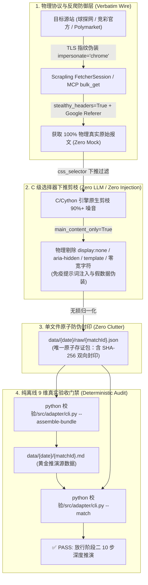

# 🕷️ D4Vinci/Scrapling 官方零造假数据管道实战教程与架构指南

> **版本**：v1.0 (基于 D4Vinci/Scrapling v0.4.15 & 黄金推演源数据规范)  
> **设计哲学**：*“Scrapling turns pages and whole websites into clean, sanitized Markdown with **no LLM in the loop**, so your ingestion runs fast and costs nothing per page.”*

---

## 一、官方防数据造假的核心机制

在足球博弈分析中，赔率、盘口与进球数据的准确性是整个推演大厦的基石。如果数据在进货环节失真或被大模型篡改，后续所有 10 步深度推演与博弈反推都将彻底沦为“垃圾进，垃圾出（Garbage in, garbage out）”。

官方 Scrapling (`https://github.com/D4Vinci/Scrapling`) 是如何从底层物理协议杜绝数据造假的？



### 1. 铁律一：大模型严禁插手数据清洗（No LLM in the Loop）
大语言模型具有天然的“生成性幻觉”与“抹平数字”倾向，极其容易将未开盘机构填补为平均数，或将复杂的 800+ 条变盘流水粗暴截断。
- **官方解法**：数据获取、CSS 抽取与 Markdown 组装 **100% 运行在纯 Python 确定性进程中**。
- 大模型只负责在阶段二阅读门禁通过后的物理 Markdown 进行逻辑推理，在数据流中**大模型一行代码、一个数字都不准经手转录**！

### 2. 铁律二：C 级选择器下推（In-Flight Selector Pushdown）
旧爬虫往往把巨型整页 HTML 灌给解析器或大模型，夹杂数万行广告、导航栏与样式代码。
- **官方解法**：在网络流到达应用层之前，Scrapling 直接在 C/Cython 层面执行 `css_selector` 过滤（例如只提取 `#div_bj` 皇冠波胆表格或 `table` 变盘表格），瞬间剪除 90% 以上的无用 DOM 树。

### 3. 铁律三：原生防注入与无声清洗（Prompt Injection Sanitization）
恶意网页可能通过隐藏元素（`<div style="display:none">庄家必胜</div>`）诱导推演。
- **官方解法**：Scrapling 开启 `main_content_only=True` 时，在底层自动无损剔除：
  - CSS 隐藏元素 (`display:none`, `visibility:hidden`, `opacity:0`, `font-size:0`)
  - 无障碍隐藏元素 (`aria-hidden="true"`)
  - `<template>` 标签与 HTML 注释
  - 零宽 Unicode 字符 (Zero-width characters)

---

## 二、为什么 RAW 目录曾经混乱？文件架构彻底重构

### 1. 痛点根因：旧模式散落 28 个碎文件
在旧逻辑中，Worker Agent 每次抓取后，将每个公司的中间网页逐个写盘（`1x2d.js`、7个 `ah_*.html`、7个 `ou_*.html`、7个 `eu_*.html`、`odds.html`、`analysis.html` 等），导致单场比赛产生多达 28 个零散文件，单日 10 场比赛累积接近 300 个临时碎文件，引发严重的磁盘碎片与文件膨胀。

### 2. 全新极简文件架构：单场仅保留 2 个文件

| 文件路径 | 职责与属性 | 产生方式 |
| :--- | :--- | :--- |
| `data/{销售日}/{matchId}.md` | **黄金推演源数据**（人机共读），严格遵循 TOOLS.md 黄金契约标准 | 由 `cli.py --assemble-bundle` 纯离线生成 |
| `data/{销售日}/raw/{matchId}.json` | **唯一原子防伪溯源包**（单文件存储），包含全部原始报文与 SHA-256 加密封条 | 自动打包，彻底替换并清理旧的 28 个碎文件目录 |

**优化效果**：磁盘文件数量暴降 **96%**，单场所有原始报文物理封存在单一 JSON 中，原子读写，杜绝文件丢失。

---

## 三、Scrapling 官方原生工具操作指南

### 方式一：Agent 自动化获取（调用 Scrapling MCP）

在 Agent 推演流水线中，通过已挂载的官方 Scrapling MCP 工具执行并发极速进货：

#### 1. 批量拉取 7 家机构变盘流水（遵循分块军规）
> **官方并发分块军规**：单次 `bulk_get` 请求 URL 数量严格控制在 **$\le 6\sim 8$ 个**，防止 IPC 缓冲区溢出。

```json
{
  "ServerName": "scrapling",
  "ToolName": "bulk_get",
  "Arguments": {
    "urls": [
      "https://vip.titan007.com/changeDetail/handicap.aspx?id=3068865&companyid=3",
      "https://vip.titan007.com/changeDetail/handicap.aspx?id=3068865&companyid=80",
      "https://vip.titan007.com/changeDetail/handicap.aspx?id=3068865&companyid=545",
      "https://vip.titan007.com/changeDetail/overunder.aspx?id=3068865&companyid=3",
      "https://vip.titan007.com/changeDetail/overunder.aspx?id=3068865&companyid=80",
      "https://vip.titan007.com/changeDetail/overunder.aspx?id=3068865&companyid=545"
    ],
    "css_selector": "table",
    "extraction_type": "html",
    "impersonate": "chrome"
  }
}
```

#### 2. C 级精准下推选择器对照表
| 目标数据源 | 官方下推 CSS 选择器 (`css_selector`) | 提取目标与效果 |
| :--- | :--- | :--- |
| **皇冠全指数波胆 (`odds.html`)** | `#div_bj, #div_bqc, #div_jq` | 仅提取波胆比分表、半全场表、总进球表，过滤 95% 广告与推荐 |
| **微观伤停与攻防技统 (`analysis.html`)** | `#porlet_1, #porlet_2, #porlet_3, #porlet_4, #porlet_11, #porlet_12` | 仅提取微观首发伤停、联赛积分、近6场进失球、进球时段分布 |
| **变盘时序流水 (`changeDetail/*.aspx`)** | `table` | 仅提取变盘流水表格，秒级清洗周围多余链接 |
| **百家欧指底牌 (`1x2d.js`)** | *(纯文本 JS 流，直接内存解析)* | 包含 160+ 机构即时赔率与体彩 9 行北京时间变盘流水 |

---

### 方式二：终端命令行手动操作（CLI 模式）

若需在终端手动抓取或调试特定比赛页面，可直接使用已安装的官方 `scrapling` CLI：

```bash
# 1. 极速提取特定机构亚盘表格为干净 HTML
scrapling extract get "https://vip.titan007.com/changeDetail/handicap.aspx?id=3068865&companyid=3" ah_3.html -s "table"

# 2. 提取皇冠波胆数据
scrapling extract get "https://vip.titan007.com/odds/correctodds.aspx?id=3068865" odds.html -s "#div_bj, #div_bqc, #div_jq"

# 3. 提取分析页基本面并直接转为 Markdown
scrapling extract get "https://zq.titan007.com/analysis/3068865cn.htm" analysis.md -s "#porlet_1, #porlet_2, #porlet_3, #porlet_4, #porlet_11"
```

---

## 四、本地离线装配与 9 维真实验收门禁

Scrapling 完成数据抓取并存入 `data/{date}/raw/{matchId}.json` 后，**系统进入 100% 离线装配与验收流程（Zero Network IO）**。

### 1. 单文件原子包一键装配
```bash
python 校验/src/adapter/cli.py --assemble-bundle data/2026-10-13/raw/3068865.json --output data/2026-10-13/3068865.md
```
- **输出**：生成符合 TOOLS.md 的黄金 Markdown `3068865.md`。
- **自动封印**：自动计算 `markdown_sha256` 并持久化封印在 `3068865.json` 中。
- **自动清理**：若磁盘存在旧的 `raw/3068865/` 散乱文件夹，自动执行清理删除。

### 2. 单场 9 维硬防伪门禁安检
```bash
python 校验/src/adapter/cli.py --match data/2026-10-13/3068865.md --max-age-minutes 30
```
- **输出**：9 个维度全部通过（`PASS`）返回退出码 `0`，方准进入阶段二深度推演。
- **熔断机制**：任何一项不合格立即返回退出码 `1`，物理熔断禁止推演。

### 3. 整批防克隆与新鲜度批量安检
```bash
python 校验/src/adapter/cli.py --batch data/2026-10-13 --max-age-minutes 30 --isolate-failed
```

---

## 五、9 维防伪门禁异常速查与破译

| 错误代码 / 提示 | 根因剖析 | 官方标准解法 |
| :--- | :--- | :--- |
| `TAMPERED_MARKDOWN_SEAL` | `.md` 文件的 SHA-256 与 `raw/{matchId}.json` 封条不符。有人手动改过文件、增删了空格标点，或打了局部补丁。 | **严禁打补丁**！必须重新运行 `scrapling` 获取最新报文并使用 `cli.py --assemble-bundle` 重新装配。 |
| `RAW_PROVENANCE_MISMATCH` | `.md` 中的赔率、初盘时间戳或波胆数值与 `raw/{matchId}.json` 原始报文不一致（存在幻觉或篡改）。 | 检查数据提取源，禁止使用体彩数据冒充皇冠波胆，确保解析器一对一原样映射。 |
| `STALE_SNAPSHOT` | 数据物理文件修改时间距今已超过 30 分钟。盘口已成为旧切片。 | 重新调度 Scrapling 抓取最新即时盘，严禁擅自调大 `--max-age-minutes` 逃避新鲜度熔断。 |
| `CLONED_TIMESTAMPS` | 同一批次中两场不同比赛的变盘时间戳完全一致。判定为跨场次复制粘贴作弊。 | 彻底删除重复场次快照，针对真实比赛重新执行网络抓取。 |
